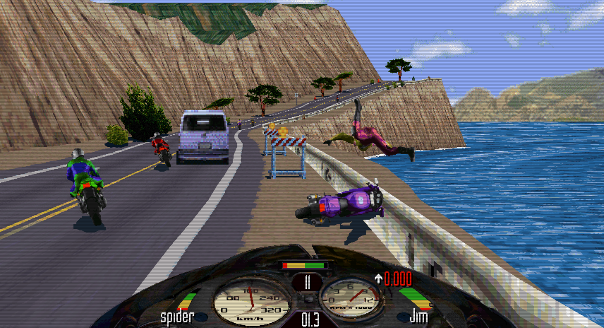
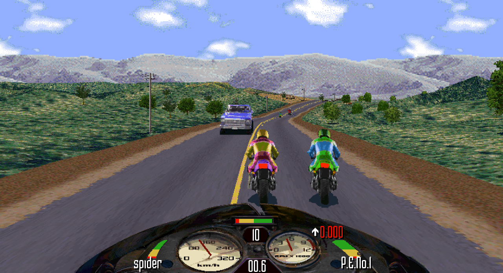
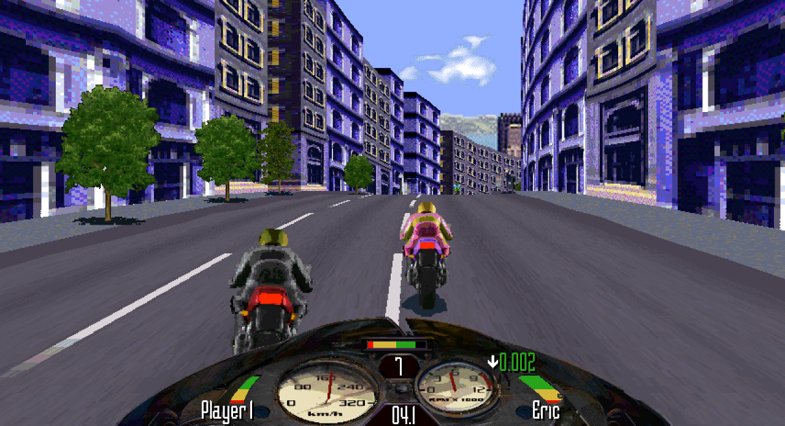
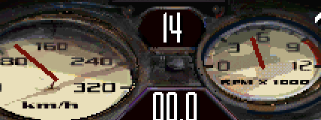
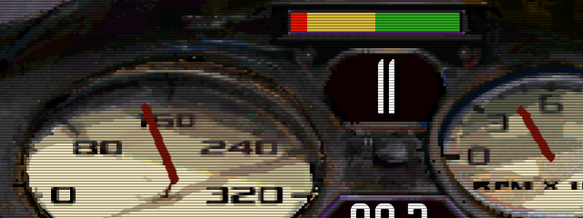
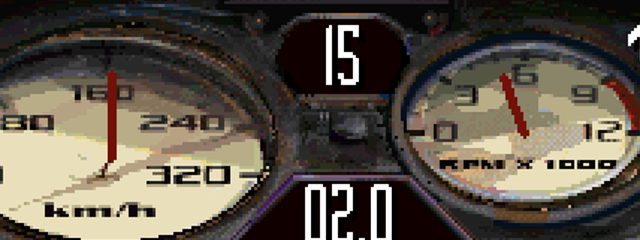

# Road Rash Widescreen Patch

A widescreen patch for the Windows 95 version of **Road Rash**. It runs the
game at your monitor's native resolution with a view that matches its aspect
ratio, so you see more of the road instead of a stretched 4:3 picture.
Optional filters smooth the classic 640x480 graphics on modern displays.

On Windows XP and newer, the patch is a drop-in `ddraw.dll` placed next to the
game. It changes nothing on disk: delete the file and the game is back to
normal. On Windows 95/98/ME, a small tool changes one import name in the game
so that it loads the patch (see [Installation](#installation)).



| | |
|---|---|
|  |  |

<sub>Screenshots taken with F12 at 2560x1440 (16:9) and reduced to half size.
Top: `hqx` with `Scanlines=35`; bottom: `nearest`.</sub>

## Features

- **Native resolution, true widescreen:** the game renders a 480-line view as
  wide as your display's aspect ratio (856x480 for 16:9, 1120x480 for 21:9),
  which is scaled to the full screen. Uses the desktop resolution by default.
- **Twice the resolution:** the race world is drawn at 960 lines (1712x960
  at 16:9) by the game's own renderer, for sharper roads, scenery and
  riders, also on Windows 98.
- **Longer view:** the road and scenery are drawn 48 segments ahead
  instead of 32, as far as the 30th Anniversary Edition shows.
- **Distance haze:** the farthest segments fade into a haze in the colors
  of the track's sky, so the road no longer pops in at the far end.
- **Fixed HUD and sky:** the cockpit, gauges and messages stay centered, and
  the sky panorama fills the whole width.
- **Display filters:** optional `nearest`, `hqx`, `xbr`, `sharp-bilinear` and
  `bicubic` filters, switchable during a race with **F11**.
- **Scanlines:** an optional CRT-style scanline effect on top of any filter.
- **No tearing:** waits for the vertical blank before each frame (can be
  turned off).
- **FPS and filter display:** optional on-screen frame rate and filter name.
- **Game fixes:** the Rat and Super bikes race in their own colors, objects
  move smoothly in 1-pixel steps, and a music volume of 0 no longer mutes the
  whole game on newer Windows. Each fix can be turned off.
- **Screenshots:** **F12** saves exactly what is on screen, at full
  resolution with the filter applied.
- **Multi-core:** filters spread their work across up to 8 CPU cores.
- **Safe:** only the supported game version is patched; anything else is left
  untouched. Menus run exactly as before.
- **Lightweight and retro-friendly:** a small DLL without runtime
  dependencies, built for Windows 98 up to Windows 11.

## Requirements

- **Road Rash for Windows 95, German version 1.0A.** The patch recognizes the
  executable by its build signature; other language versions or releases are
  not patched (the game then runs as usual). Support for more versions may
  follow.
- The game option **High Resolution** (640x480) must be enabled.
- Windows 98 or newer. The patch is tested on Windows 98 SE and Windows 11.
- The display filters need a 32-bit display mode at your resolution and
  benefit from a multi-core CPU. Without filters, the game's original 8-bit
  display mode is used.

## Installation

Download a release (or [build](#building) the patch yourself), then follow the
steps for your Windows version. Never replace the `ddraw.dll` in the Windows
system folder.

### Windows XP and newer

1. Copy `ddraw.dll` and `RoadRashWidescreen.ini` into the game folder, next
   to `ROADRASH.EXE`.
2. Optional: adjust `RoadRashWidescreen.ini` (see
   [Configuration](#configuration)).
3. Start the game and make sure **High Resolution** is enabled.

To uninstall, delete `ddraw.dll` (and the ini, log and screenshot files the
patch created) from the game folder.

### Windows 95, 98 and ME

Windows 9x ignores a `ddraw.dll` in the game folder and keeps using the system
one, which its DirectSound also depends on. The game therefore loads the patch
under another name, `RRWS.dll` (the same DLL as `ddraw.dll`):

1. Copy `RRWS.dll`, `RRWSPatch.exe` and `RoadRashWidescreen.ini` into the game
   folder, next to `ROADRASH.EXE`. Do not copy `ddraw.dll`.
2. Run `RRWSPatch.exe` and confirm. It changes the `DDRAW.dll` import of
   `ROADRASH.EXE` to `RRWS.dll` (these 9 bytes are the only change) and saves
   the unchanged program as `ROADRASH.BAK`. Only the supported version 1.0A is
   changed.
3. Start the game as usual and make sure **High Resolution** is enabled.

Keep `RRWS.dll` next to the changed `ROADRASH.EXE`: without it the game does
not start. To uninstall, run `RRWSPatch.exe` again to restore the original
import (or copy `ROADRASH.BAK` back to `ROADRASH.EXE`), then delete the patch
files. The changed `ROADRASH.EXE` also works on newer Windows with `RRWS.dll`.

## Configuration

All settings are optional. `RoadRashWidescreen.ini` next to `ROADRASH.EXE`
holds them; the release includes it with every setting explained (source:
[`dist/RoadRashWidescreen.ini`](dist/RoadRashWidescreen.ini)). Missing or
invalid values fall back to their defaults.

```ini
[Display]
DisplayWidth=0   ; 0 (default) = desktop width, or a width in pixels
DisplayHeight=0  ; 0 (default) = desktop height, or a height in pixels
VirtualWidth=0   ; 0 (default) = fit the display's aspect ratio, or 640-1280
WaitForVBlank=1  ; 1 (default) = wait for vertical blank, 0 = no wait
Filter=none      ; none (default), nearest, hqx, xbr, sharp-bilinear, bicubic
HqxScale=0       ; hqx/xbr factor: 0 (default) = auto, or 2, 3, 4 (hqx: up to 3)
DrawDistance=48  ; road segments drawn ahead: 48 (default) or down to 32 (original)
DistanceFade=16  ; farthest segments that fade into a haze: 16 (default), 1-16, 0 = off
DirectPresent=1  ; 1 (default) = filters write into the screen, 0 = copy each frame
Scanlines=0      ; 0 (default) = off, or 1-100 = scanline darkening in percent
ShowFps=0        ; 0 (default) = off, 1 = show the frame rate during races
ShowFilter=0     ; 0 (default) = off, 1 = show the active filter's name
RenderScale=2    ; 2 (default) = race world at 960 lines, 1 = the original 480 lines

[Fixes]
FixBikeColors=1   ; 1 (default) = Rat and Super bikes in their own colors, 0 = original
SmoothSprites=1   ; 1 (default) = objects move in 1-pixel steps in HiRes, 0 = original
MidiVolumeGuard=1 ; 1 (default) = music volume 0 no longer mutes the game, 0 = original
FullRateObjects=1 ; 1 (default) = riders and cars in view update every tick, 0 = original
```

| Setting | Description |
|---|---|
| `DisplayWidth`, `DisplayHeight` | The screen resolution used during races. If it is not available, 1920x1080 is tried, then 720x480, then the game's original 640x480. |
| `VirtualWidth` | The width the game renders at (multiple of 8). By default it matches your display's aspect ratio; other values change the aspect ratio. |
| `WaitForVBlank` | Prevents tearing, but limits the frame rate to the monitor's refresh rate. |
| `Filter` | The display filter, see [Filters](#filters). `none` keeps the game's original 8-bit display mode. |
| `HqxScale` | Scale factor of the pixel-art filters `hqx` and `xbr` (2, 3 or 4; `hqx` stops at 3); their result is then scaled smoothly to the screen. The automatic choice is the smallest factor that reaches the screen height: 2 up to 960 lines, 3 up to 1440 lines (so at 1080p the 3x result is reduced: supersampling), 4 above, e.g. for 4K. A lower factor is faster. |
| `DrawDistance` | How many road segments ahead the game draws, 48 by default. The original draws 32, although it loads 80 ahead; up to 48 shows the road and scenery further into the distance (48 is also what the 30th Anniversary Edition draws). Riders, cars and pedestrians still appear at the original distance. The road arrays, the crest thresholds and the depth table are enlarged in memory for it. |
| `DistanceFade` | How many of the farthest road segments fade into a haze (16 by default), so new segments appear out of it instead of popping in whole. The haze grows toward the far end to 3/4 and takes its color from the track's sky panorama; the game's 256-color palette is remapped for it, so the steps may show slight color shifts. 0 turns it off. |
| `DirectPresent` | Only for the filters other than `none`. With `1`, a filter whose output has the screen size writes straight into the screen surface after the vertical blank, instead of into system memory that is then copied to the graphics card. That copy took 8 ms per frame at 1920x1080 on a Windows 98 PC. While `Scanlines` are on (which read the frame back), frames are still copied, except with `nearest`. If the screen surface cannot be locked, the frame is copied as with `0`. |
| `Scanlines` | Strength of the scanline effect; 30 to 50 is a good start. |
| `ShowFps`, `ShowFilter` | On-screen display in the top-left corner, for example `60 FPS  BICUBIC`. |
| `RenderScale` | `2` (default) makes the game's own rasterizer draw the race world at twice the resolution (960 lines, 1712x960 at 16:9), so roads, scenery and riders are sharper; the sky and the cockpit are enlarged from their 480-line art. It works with `none`, `nearest`, `sharp-bilinear` and `bicubic`. `hqx` and `xbr` are made for the original 480-line pixel grid, so with `2` they fall back to `sharp-bilinear` and F11 skips them; set `RenderScale=1` to use them. On a Windows 98 PC with a Pentium Dual-Core E5800 at 1920x1080, `none` runs at 59 fps (5.4 ms of game time per frame); with `WaitForVBlank=0`, `nearest` reaches 59 fps, `sharp-bilinear` 44 and `bicubic` 28. |
| `FixBikeColors` | The original game swaps the race colors of the Rat and Super bikes (the shop shows them correctly). The fix swaps the two groups of color tables back. |
| `SmoothSprites` | In High Resolution mode the game keeps every corner of buildings, riders and cars on an even pixel, so they move in 2-pixel steps (about 4.5 screen pixels at 1080p). The fix uses the full 640x480 precision. |
| `MidiVolumeGuard` | The game sets its music volume with `midiOutSetVolume`. Since Windows Vista, that call changes the volume of the whole game in the Windows volume mixer, and Windows keeps it, so a music volume of 0 also silenced all sound effects. With the fix, a song at volume 0 is not started at all, as when music is muted. Other volumes are passed on unchanged. |
| `FullRateObjects` | The game updates each rider, car, pedestrian and cop at an interval that grows with its distance from the camera: every game tick close by, up to every 8th tick about 30 segments ahead. Their position still follows the elapsed time, so in the distance they move in visible jumps. With the fix, every one of them within the drawn range (4 segments behind to 33 ahead) is updated on every tick; the ones further away keep the original interval. |

## Filters

The game draws at 960 lines (`RenderScale=2`) or 480 lines, so the picture
is always enlarged. A filter decides how:

| Filter | Look | Best for |
|---|---|---|
| `none` | Original look, the game's 8-bit display mode. | Maximum compatibility, slow PCs. |
| `nearest` | Sharp, blocky pixels. | The authentic pixel look. |
| `hqx` | Smooths edges between flat colors (hq2x/hq3x). | Pixel-art style. |
| `xbr` | Like hqx, with rounder outlines and cleaner diagonals. | Pixel-art style. |
| `sharp-bilinear` | Crisp pixels of even size, also at non-integer scales such as 1080p. | A clean pixel look on any resolution. |
| `bicubic` | Smooth, photo-like enlargement; also softens the game's blocky near sprites. | A soft, modern look. |

The cockpit at 2560x1440, unscaled crops (with `Scanlines=35`, which
`nearest` does not show):

| Filter | Result |
|---|---|
| `nearest` |  |
| `hqx` |  |
| `xbr` |  |
| `sharp-bilinear` |  |
| `bicubic` |  |

With any filter except `none`, press **F11** during a race to cycle through
`nearest`, `hqx`, `xbr`, `sharp-bilinear` and `bicubic`; the choice is kept
for later races. Switching to or from `none` requires restarting the game.
`Scanlines` apply to every filter except `nearest`.

`hqx` and `xbr` enlarge by a whole factor (2x to 4x); their result is then
scaled to the exact screen size with area averaging. That avoids doubled
rows and columns at non-integer sizes such as 1080p or 4K, and at 1080p the
3x result is reduced, which gives a supersampled, particularly clean picture.

On a modern CPU every filter takes only a few milliseconds per frame. On a
single-core CPU such as a Pentium 4, `sharp-bilinear` is the fastest choice;
`bicubic` and `xbr` are only practical at low resolutions there.

## Hotkeys

| Key | Action |
|---|---|
| **F11** | Cycle through the display filters (during a race, with a filter enabled). |
| **F12** | Save a screenshot of the screen as `RoadRashScreen001.bmp`, `002`, ... in the game folder. It shows exactly what is displayed, including filter, scanlines and on-screen display. The game's unscaled frame (1712x960 at 16:9 with `RenderScale=2`) is also saved as `RoadRashFrame.bmp` (replaced each time). |

## Troubleshooting

The patch writes `RoadRashWidescreen.log` to the game folder each time the
game starts. It shows whether the game version was recognized, which display
mode and filter are used, and, per filter, how the time of a frame is spent.
Please attach it when reporting a problem.

- **No log file at all:** the game did not load the patch. On Windows
  95/98/ME, use `RRWS.dll` and `RRWSPatch.exe` as described in
  [Installation](#installation); a `ddraw.dll` in the game folder is ignored
  there.
- **Nothing changes:** make sure **High Resolution** is enabled and check the
  log for the recognized game version.
- **No filter, although one is set:** the 32-bit display mode is not available
  at your resolution; the log says so and the game runs in 8-bit mode.
- **Low frame rate with a filter:** try `sharp-bilinear`, a lower `HqxScale`,
  `WaitForVBlank=0`, `RenderScale=1` or `Filter=none`.

## Building

Requirements:

- Microsoft Visual Studio 2005 (Visual C++ 8)
- Microsoft Platform SDK (expected at `C:\Program Files\Microsoft Platform SDK`)
- Git, to fetch the [hqx](https://github.com/brunexgeek/hqx) submodule

```bat
git clone --recursive <repository-url>
cd roadrash-widescreen
build.cmd
```

In an existing clone, run `git submodule update --init` first. In VS Code,
**Terminal > Run Build Task** (Ctrl+Shift+B) runs the same script. If Visual
Studio 2005 or the Platform SDK is installed elsewhere, set `VS80_ROOT` or
`PLATFORM_SDK_ROOT` to its folder before building.

The result is `build\ddraw.dll`: a 32-bit x86 DLL without C runtime
dependencies, linked for Windows subsystem 4.0 so that it also loads on
Windows 98. It also builds `build\RRWSPatch.exe`, the Windows 9x setup tool
(likewise without C runtime).

The script also assembles the release package in `build\release\`: the DLL
(as `ddraw.dll` and as `RRWS.dll`), `RRWSPatch.exe`, the player documentation and default settings from [`dist/`](dist/)
(`README.txt`, `RoadRashWidescreen.ini`), and the license texts as
`LICENSE.txt` and `THIRD_PARTY_NOTICES.txt`. Zip that folder for a release.

## How it works

- The proxy forwards all DirectDraw calls to the system's `ddraw.dll` and
  patches only the supported Road Rash executable, in memory.
- When a race starts, the display is set to the native resolution while the
  game renders into a wider 960-line (or 480-line) buffer, which is scaled to
  the screen on every frame. For 960 lines, the game's own rasterizer gets
  larger edge tables and converts its 3D coordinates at twice the scale; the
  sky and the HUD exist as 480-line art and are enlarged into the frame. Two game routines are redirected while racing: the HUD is
  drawn centered, and the sky panorama is tiled across the whole width. Both
  are restored when returning to the menu.
- With a filter, the display runs at 32 bits per pixel. The game keeps
  rendering 8-bit frames, which are converted through the game palette,
  filtered and then presented.

## Known limitations

- Only the German version 1.0A is supported so far.
- On Windows 95/98/ME, `ROADRASH.EXE` must be changed with `RRWSPatch.exe`
  (one import name), because a `ddraw.dll` next to the game is not loaded.
- With `WaitForVBlank=0`, tearing is possible.
- The 720x480 fallback mode uses no filter and shows no on-screen display.
- The patch does not chain through other DirectDraw wrappers such as
  DDrawCompat or dgVoodoo2.

## License

Copyright (C) 2026 Alexander Schmidt

This program is free software: you can redistribute it and/or modify it under
the terms of the GNU General Public License as published by the Free Software
Foundation, either version 3 of the License, or (at your option) any later
version. It is distributed in the hope that it will be useful, but WITHOUT ANY
WARRANTY; without even the implied warranty of MERCHANTABILITY or FITNESS FOR A
PARTICULAR PURPOSE. See `LICENSE` for the full text.

The [hqx](https://github.com/brunexgeek/hqx) library by Bruno Ribeiro is
licensed under the Apache License 2.0 and compiled into `ddraw.dll`; the xBR
filter implements an algorithm by Hyllian. See `THIRD_PARTY_NOTICES.md`,
which must accompany any distribution of `ddraw.dll`.

Road Rash is a trademark of Electronic Arts. This project is not affiliated
with or endorsed by Electronic Arts, contains no game files, and requires an
original copy of the game.
