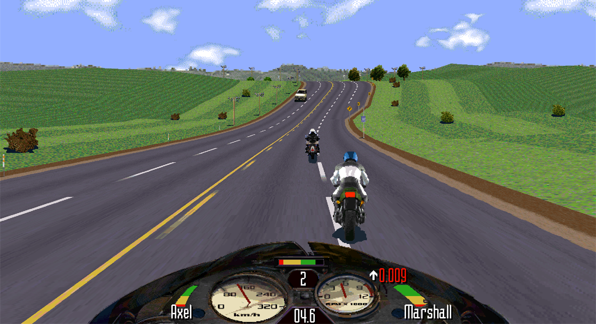
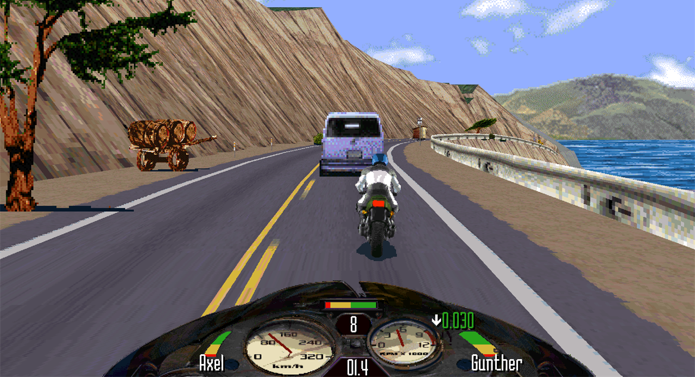
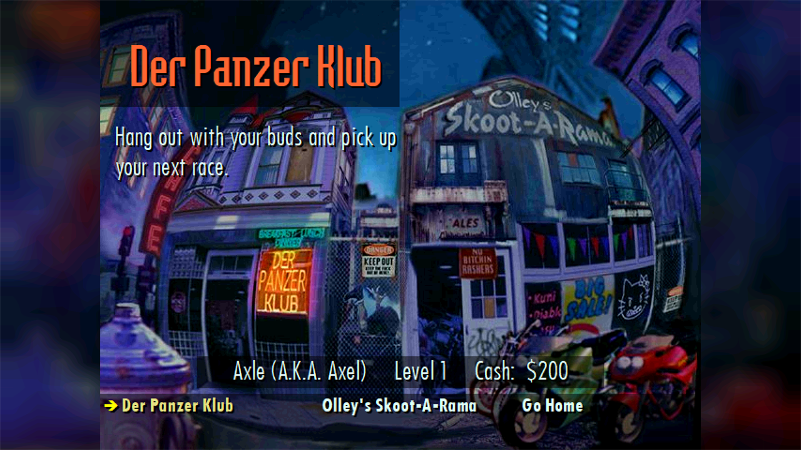
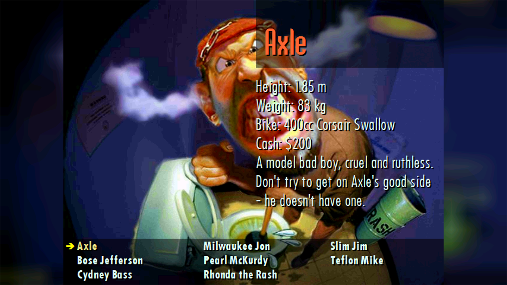

# Road Rash Widescreen Patch

**Native resolution, higher resolution, a longer view and fixes for the
original 1996 PC version of Road Rash, from Windows 95 to Windows 11.**

[Features](#features) · [Fixes](#fixes) · [Requirements](#requirements) · [Installation](#installation) · [Configuration](#configuration) · [Hotkeys](#hotkeys) · [Troubleshooting](#troubleshooting) · [Building](#building) · [Known limitations](#known-limitations) · [Credits](#credits) · [License](#license)

A widescreen patch for the Windows 95 version of **Road Rash**. It runs the
game at your monitor's native resolution with a view that matches its aspect
ratio, so you see more of the road instead of a stretched 4:3 picture.
Optional filters smooth the classic graphics on modern displays.
**[Download the latest release](https://github.com/alex-286/roadrash-widescreen/releases/latest).**

On Windows XP and newer, the patch is a drop-in `ddraw.dll` placed next to the
game. It changes nothing on disk: delete the file and the game is back to
normal. On Windows 95/98/ME, a small tool changes one import name in the game
so that it loads the patch (see [Installation](#installation)).



| | |
|---|---|
|  |  |
|  |  |

<sub>Screenshots taken with F12 at 2560x1440 (16:9) with the default
settings and reduced to half size. Races: `Filter=none`, a few rows cut off
at the top. Menus: the whole screen, with the blurred menu picture around
the menu.</sub>

## Features

- **Native resolution, true widescreen:** the game renders a view as wide as
  your display's aspect ratio (1712x960 at 1920x1080, 2568x1440 at
  2560x1440), which is scaled to the full screen. Uses the desktop resolution by default.
- **Higher resolution:** the race world is drawn at up to four times the
  original 480 lines by the game's own renderer, as many as fit your screen
  (960 lines at 1080p, 1440 at 1440p), for sharper roads, scenery and
  riders, also on Windows 98.
- **Longer view:** the road, its scenery (walls, rock faces, trees,
  buildings, signs) and the riders, cars and pedestrians are drawn 48
  segments ahead instead of the game's 32, as far as the 30th Anniversary
  Edition shows.
- **Distance haze:** the farthest segments fade into a haze in the colors
  of the track's sky, so the road no longer pops in at the far end.
- **Fixed HUD and sky:** the cockpit, gauges and messages stay centered, and
  the sky panorama fills the whole width.
- **Menus at the native resolution:** the screen no longer switches to
  640x480 for the menus. The menu fills the screen height in the middle,
  surrounded by a blurred copy of the menu picture, and the videos are
  enlarged by a whole factor.
- **Display filters:** optional `nearest`, `sharp-bilinear` and `bicubic`
  filters, switchable during a race with **F11**.
- **Scanlines:** an optional CRT-style scanline effect with `sharp-bilinear`
  and `bicubic`.
- **No tearing:** waits for the vertical blank before each frame (can be
  turned off).
- **FPS and filter display:** optional on-screen frame rate and filter name.
- **Screenshots:** **F12** saves exactly what is on screen, at full
  resolution with the filter applied, in races and in the menus.
- **Multi-core:** filters spread their work across up to 8 CPU cores.
- **Safe:** only the supported game version is patched; anything else is left
  untouched. On Windows 9x, every DirectDraw hook is removed when the game
  ends, because DirectDraw is shared by all programs there.
- **Lightweight and retro-friendly:** a small DLL without runtime
  dependencies, built for Windows 95 up to Windows 11.

## Fixes

The patch also repairs faults of the original game. Each fix can be turned
off in [Configuration](#configuration).

- **Bike colors:** the Rat and Super bikes race in their own colors, as the
  shop shows them.
- **Smooth movement:** buildings, riders and cars move in fine steps instead
  of jumping by two pixels, and riders and cars in the distance no longer
  move in jumps.
- **Punch shadow:** the rider's shadow stays under the bike when punching.
- **Grounded buildings:** three buildings that hover above the ground stand
  on it.
- **Odometer:** the distance in the cockpit no longer wraps to 0 after 25.5.
- **Steady road:** the road and its edges no longer jump by a few pixels
  while riding.
- **Music volume:** a music volume of 0 no longer mutes the whole game on
  newer Windows, and a sound card that cannot set the volume no longer stops
  the race music.
- **MIDI errors:** when the race music cannot start, the game no longer
  seems to freeze behind a hidden error message; the race starts without
  music.
- **Silent races:** if the races have no music while the menus do, the race
  music can play on another MIDI output.
- **Alt+Tab (optional):** Alt+Tab and the Windows key switch away from the
  game while it keeps running.

## Requirements

- **Road Rash for Windows 95, version 1.0A**: the `ROADRASH.EXE` of
  23 August 1996, 541,184 bytes (SHA-256 `73d7f974…60f18a2`).
- The game installed. Its 16-bit installer does not run on 64-bit Windows; see
  [the manual installation on PCGamingWiki](https://www.pcgamingwiki.com/wiki/Road_Rash#Installing_Retail_version_on_64-bit_versions_of_Windows).
- The game option **High Resolution** (640x480) must be enabled.
- Windows 95 or newer. The patch is tested on Windows 98 SE and Windows 11.
  It uses only functions that Windows 95 already has, so it should also run
  on Windows 95, ME and the versions from XP to 10, but these are untested.
- The display filters need a 32-bit display mode at your resolution and
  benefit from a multi-core CPU. Without filters, the game's original 8-bit
  display mode is used.
- The menus at the native resolution need a 16-bit display mode at that
  resolution; without it, the menus run at 640x480 as in the original.

## Installation

Download a release (or [build](#building) the patch yourself), then follow the
steps for your Windows version. Never replace the `ddraw.dll` in the Windows
system folder.

### Windows XP and newer

1. Copy `ddraw.dll` and `RoadRashWidescreen.ini` into the game folder, next
   to `ROADRASH.EXE`.
2. Optional: adjust `RoadRashWidescreen.ini` (see
   [Configuration](#configuration)).
3. Start the game and make sure **High Resolution** is enabled.

To uninstall, delete `ddraw.dll` (and the ini, log and screenshot files the
patch created) from the game folder.

### Windows 95, 98 and ME

Windows 9x ignores a `ddraw.dll` in the game folder and keeps using the system
one, which its DirectSound also depends on. The game therefore loads the patch
under another name, `RRWS.dll` (the same DLL as `ddraw.dll`):

1. Copy `RRWS.dll`, `RRWSPatch.exe` and `RoadRashWidescreen.ini` into the game
   folder, next to `ROADRASH.EXE`. Do not copy `ddraw.dll`.
2. Run `RRWSPatch.exe` and confirm. It changes the `DDRAW.dll` import of
   `ROADRASH.EXE` to `RRWS.dll` (these 9 bytes are the only change) and saves
   the unchanged program as `ROADRASH.BAK`. Only the supported version 1.0A is
   changed.
3. Start the game as usual and make sure **High Resolution** is enabled.

Keep `RRWS.dll` next to the changed `ROADRASH.EXE`: without it the game does
not start. To uninstall, run `RRWSPatch.exe` again to restore the original
import (or copy `ROADRASH.BAK` back to `ROADRASH.EXE`), then delete the patch
files. The changed `ROADRASH.EXE` also works on newer Windows with `RRWS.dll`.

### Together with another DirectDraw wrapper

A DirectDraw wrapper (for example for borderless fullscreen) is also a
`ddraw.dll` in the game folder. On Windows XP and newer, the patch runs in
front of it:

1. Rename the wrapper's `ddraw.dll` (for example to `wrapper.dll`) and keep
   it in the game folder.
2. Copy the patch's `ddraw.dll` next to it.
3. Set `ChainDll=wrapper.dll` in the `[Display]` section of
   `RoadRashWidescreen.ini`.

The patch then passes the game's DirectDraw calls on to the wrapper; the log
says `Loaded the DirectDraw library named by ChainDll`. A wrapper that only
works under the name `ddraw.dll` goes into a subfolder instead, for example
`Wrapper\ddraw.dll` with `ChainDll=Wrapper\ddraw.dll`.

Tested on Windows 11 with [DDrawCompat](https://github.com/narzoul/DDrawCompat)
0.7.2. It turns itself off next to another `ddraw.dll`, so it goes into a
subfolder: `DDrawCompat\ddraw.dll` with `ChainDll=DDrawCompat\ddraw.dll`.

Tested on Windows 11 with [cnc-ddraw](https://github.com/FunkyFr3sh/cnc-ddraw)
7.1.0.0 in a subfolder: `cnc-ddraw\ddraw.dll`, with its `ddraw.ini` next
to it, and `ChainDll=cnc-ddraw\ddraw.dll`.

## Configuration

All settings are optional. `RoadRashWidescreen.ini` next to `ROADRASH.EXE`
holds them; the release includes it with every setting explained (source:
[`dist/RoadRashWidescreen.ini`](dist/RoadRashWidescreen.ini)). Missing or
invalid values fall back to their defaults.

```ini
[Display]
DisplayWidth=0   ; 0 (default) = desktop width, or a width in pixels
DisplayHeight=0  ; 0 (default) = desktop height, or a height in pixels
VirtualWidth=0   ; 0 (default) = fit the display's aspect ratio, or 640-1280
WaitForVBlank=1  ; 1 (default) = wait for vertical blank, 0 = no wait
Filter=none      ; none (default), nearest, sharp-bilinear, bicubic
DrawDistance=48  ; road segments drawn ahead: 48 (default) or down to 32 (original)
DistanceFade=16  ; farthest segments that fade into a haze: 16 (default), 1-16, 0 = off
DirectPresent=1  ; 1 (default) = filters write into the screen, 0 = copy each frame
Scanlines=0      ; 0 (default) = off, or 1-100 = scanline darkening in percent
ShowFps=0        ; 0 (default) = off, 1 = show the frame rate during races
ShowFilter=0     ; 0 (default) = off, 1 = show the active filter's name
RenderScale=0    ; 0 (default) = most lines that fit the screen, 1 = original 480 lines, 2-4 = 960-1920 lines
NativeMenus=1    ; 1 (default) = menus enlarged in the middle of the native resolution, 0 = 640x480
MenuBackground=1 ; 1 (default) = the menu picture blurred around the menu, 0 = black
ChainDll=        ; empty (default) = the Windows DirectDraw library, or the file name of another one

[Fixes]
FixBikeColors=1   ; 1 (default) = Rat and Super bikes in their own colors, 0 = original
SmoothSprites=1   ; 1 (default) = objects move in 1-pixel steps in HiRes, 0 = original
MidiVolumeGuard=1 ; 1 (default) = music volume 0 no longer mutes the game, and the music plays on if the driver cannot set the volume, 0 = original
MusicDevice=-1    ; -1 (default) = race music on the MIDI mapper, or the number of a MIDI output
MidiErrorsToLog=1 ; 1 (default) = a race music error goes to the log instead of a message box, 0 = original
FullRateObjects=1 ; 1 (default) = riders and cars in view update every tick, 0 = original
FixPunchShadow=1  ; 1 (default) = the shadow stays under the bike when punching, 0 = original
GroundBuildings=1 ; 1 (default) = three hovering buildings stand on the ground, 0 = original
FixOdometer=1     ; 1 (default) = the distance no longer wraps to 0 after 25.5, 0 = original
SmoothRoad=1      ; 1 (default) = the road and its edges move without jumps, 0 = original
AllowAltTab=0     ; 0 (default) = Alt+Tab and the Windows key blocked, 1 = Alt+Tab and the Windows key work
```

| Setting | Description |
|---|---|
| `DisplayWidth`, `DisplayHeight` | The screen resolution used during races. If it is not available, 1920x1080 is tried, then 720x480, then the game's original 640x480. |
| `VirtualWidth` | The width the game renders at (multiple of 8). By default it matches your display's aspect ratio; other values change the aspect ratio. |
| `WaitForVBlank` | Prevents tearing, but limits the frame rate to the monitor's refresh rate. |
| `Filter` | How the frame is scaled to the screen: `nearest` (sharp, blocky pixels), `sharp-bilinear` (crisp pixels of even size, also at non-integer scales) or `bicubic` (smooth). **F11** cycles through them during a race. `none` keeps the game's original 8-bit display mode; switching to or from it requires restarting the game. |
| `DrawDistance` | How many road segments ahead the game draws, 48 by default. The original draws 32, although it loads 80 ahead; up to 48 shows the road further into the distance (48 is also what the 30th Anniversary Edition draws). The scenery beside the road (walls, rock faces, trees, buildings, signs) is drawn out to the full distance once the game has loaded its pictures, which it does for the original distance; until then, a far segment shows only the road. Riders, cars and pedestrians appear out to the same distance; the list of objects the game draws holds proportionally more of them for it (75 at 48 segments instead of 50). The road arrays, the crest thresholds and the depth table are enlarged in memory for it. |
| `DistanceFade` | How many of the farthest road segments fade into a haze (16 by default), so new segments appear out of it instead of popping in whole. The haze grows toward the far end to 3/4 and takes its color from the track's sky panorama. With a filter other than `none` and `RenderScale` above 1, the filter blends the haze into each pixel in full color, so it is smooth. Otherwise the game's 256-color palette is remapped for it, so the steps may show slight color shifts. 0 turns it off. |
| `DirectPresent` | Only for the filters other than `none`. With `1`, a filter whose output has the screen size writes straight into the screen surface after the vertical blank, instead of into system memory that is then copied to the graphics card. On older PCs that copy can take several milliseconds per frame. While `Scanlines` are on (which read the frame back), frames are still copied, except with `nearest`. If the screen surface cannot be locked, the frame is copied as with `0`. |
| `Scanlines` | Strength of the scanline effect with `sharp-bilinear` and `bicubic`; 30 to 50 is a good start. |
| `ShowFps`, `ShowFilter` | On-screen display in the top-left corner, for example `60 FPS  BICUBIC`. |
| `RenderScale` | How many times the original 480 lines the game's own rasterizer draws the race world at, so roads, scenery and riders are sharper; the sky and the cockpit are enlarged from their 480-line art. `0` (default) picks for each race the most lines that fit the height of its display mode: 2 (960 lines, 1712x960 at 16:9) at 1080 lines, 3 (1440 lines) at 1440 lines, 4 (1920 lines) at 2160 lines or more, and 1 below 960 lines. `1` keeps the original 480 lines, for very slow PCs; `2`, `3` and `4` draw 960, 1440 or 1920 lines on every screen. Each step draws more pixels and costs speed; on older PCs, use `1` or `2`, and with a filter other than `none` try `WaitForVBlank=0` for a higher frame rate. |
| `NativeMenus` | The game's menus are a Windows interface of 640x480: a main window with the buttons as windows of their own, dialogs and a video window. Windows 98 cannot enlarge such windows, so with `1` the screen stays at the resolution of the races (in 16-bit color), the menu fills the screen height in the middle (2.25x at 1920x1080, 3x at 2560x1440; with a factor that is not a whole number, some rows and columns of pixels are one screen pixel wider than others, and the mouse, the windows and the drawing all use the same mapping), and the videos are enlarged by the largest whole factor of their own size that fits (320x192 videos: 5x at 1920x1080, 7x at 2560x1440), on black. Everything visible in the menus is drawn by copying rectangles into the screen, so the patch enlarges those copies; the game's main window covers the whole screen as in the original, its invisible button windows are enlarged the same way, and the positions the game reads (window rectangles, the mouse, paint areas) come back in its 640x480 coordinates. Windows dialogs (the save dialog, message boxes) keep their size and are centred. With `0`, the screen switches to 640x480 for the menus as in the original game. |
| `MenuBackground` | Only with `NativeMenus=1`: what fills the screen around the menu. With `1`, each new menu screen is averaged into a grid of 32x24 colors, which is stretched smoothly over the screen and darkened: the menu picture, enlarged and heavily blurred, made at runtime from the game's own picture. It is drawn only when the game shows a whole new menu screen, not for every small change. With `0` the area stays black. Videos always play on black. |
| `ChainDll` | Another DirectDraw library that the patch passes the game's DirectDraw calls on to, instead of the one of Windows, see [Together with another DirectDraw wrapper](#together-with-another-directdraw-wrapper). A relative path starts in the folder of `ROADRASH.EXE`. If the library cannot be loaded, the patch uses the Windows one and says so in the log. |
| `FixBikeColors` | The original game swaps the race colors of the Rat and Super bikes (the shop shows them correctly). The fix swaps the two groups of color tables back. |
| `SmoothSprites` | In High Resolution mode the game keeps every corner of buildings, riders and cars on an even pixel, so they move in 2-pixel steps (about 4.5 screen pixels at 1080p). The fix uses the full 640x480 precision. |
| `MidiVolumeGuard` | The game sets its music volume with `midiOutSetVolume`. Since Windows Vista, that call changes the volume of the whole game in the Windows volume mixer, and Windows keeps it, so a music volume of 0 also silenced all sound effects. With the fix, a song at volume 0 is not started at all, as when music is muted. Other volumes are passed on unchanged. If the MIDI driver cannot set the volume (for example an external MIDI port, or a synthesizer without volume control), the original game reports a "MIDI Error" and treats the music as off, although the song has already started, so it no longer stops that song later. With the fix, the song plays on at the driver's own volume and the game stops it as usual; the log records the failed call. |
| `MusicDevice` | The race music (`AUDIO\MUSIC\GRUNGE1-5.MID`, MIDI stream files that Media Player cannot play) is played on the MIDI mapper, which uses the output chosen in the Windows Control Panel; the menus play their music from the video files instead. If the mapper leads to an external MIDI port, the races stay silent while everything else works. The log lists every MIDI output with its number and type at the first race; `MusicDevice` set to one of these numbers plays the race music on that output (and the game's music volume goes to it), `-1` (default) keeps the mapper. The log also records each music start and every MIDI call that fails. |
| `MidiErrorsToLog` | If the race music cannot start (no usable MIDI output, a MIDI call that fails, or a missing song file), the game shows a "MIDI Error" message box with a warning sound and waits until it is closed. In fullscreen the box can stay hidden behind the picture, so the game seems to hang until **Enter** is pressed. With the fix, the error is written to the log instead, and the race starts without music, as after the box. |
| `FullRateObjects` | The game updates each rider, car, pedestrian and cop at an interval that grows with its distance from the camera: every game tick close by, up to every 8th tick about 30 segments ahead. Their position still follows the elapsed time, so in the distance they move in visible jumps. With the fix, every one of them from 4 segments behind to 33 ahead (the range the original game draws) is updated on every tick; the ones further away keep the original interval. |
| `FixPunchShadow` | The rider's shadow frames (`DATA\BIKERS\HISHADOW.DAT`, `LOSHADOW.DAT`) are drawn centred on their box. In frame 176, the first frame of the punch, a few stray pixels in the top corner make the box 118x168 (59x84) while the shadow is only the 13 (6) rows at its bottom, so the shadow jumps away from the bike. The fix cuts the loaded frame to the shadow itself (64x13, 32x6); the file is not changed. |
| `GroundBuildings` | The pictures of the red barn (`BARN12`), the brown shop with the sign (`RUSTICA2`) and the white house (`HOUSEB2`) in `FAMILIES.RSC` end in empty rows, and the game places them as if the picture reached the bottom of the texture, so they hover. The fix draws them 2, 3 and 10 rows of their picture lower, found by the texture name; only the drawing changes. |
| `FixOdometer` | The game computes the distance in the cockpit in tenths of a mile (of a kilometer with metric units) but keeps only one byte of it, so the display wraps to 0 after 25.5, which most courses in kilometers pass, and shows 25.x before the start line. The fix keeps the whole value; the display starts at 0.0 and goes up to 999.9. |
| `SmoothRoad` | The game projects the road ahead segment by segment, starting from the camera's position within its segment. It starts the height and the bend of the first segment in whole units and drops the rest, so the road is up to one unit too high and every segment further ahead a little further to the side. Whenever the whole parts change, the road and its edges jump by a few pixels near the camera (twice as many at 960 lines). The fix adds the dropped parts back to the screen positions of every plain road segment; segments of other kinds are left as the game computes them. |
| `AllowAltTab` | The compatibility database of Windows (`sysmain.sdb`) applies its IgnoreAltTab fix to `ROADRASH.EXE`. That fix runs a keyboard hook in the game that swallows Alt+Tab, Alt+Esc, Ctrl+Esc and the Windows and menu keys. With `1`, the patch ends the thread of that hook when the game starts DirectDraw, and Windows removes the hook with it; the log says whether it worked. Windows 95/98/ME do not have the fix, but there the game blocks the keys itself: a keyboard hook of its own discards Tab while Alt is held, and its windows keep Alt+Tab, Alt+Esc and the commands for switching from Windows. With `1`, the patch removes that hook and gives these keys and commands of the game's windows to Windows. In both cases the game keeps running in the background, and Alt+Tab brings it back. Tested on Windows 98 SE, and on Windows 11 with the Windows DirectDraw library and with DDrawCompat. |

## Hotkeys

| Key | Action |
|---|---|
| **F11** | Cycle through the display filters (during a race, with a filter enabled). |
| **F12** | Save a screenshot of the screen as `RoadRashScreen001.bmp`, `002`, ... in the game folder. In a race it shows exactly what is displayed, including filter, scanlines and on-screen display, and the game's unscaled frame (1712x960 at 16:9 with `RenderScale=2`) is also saved as `RoadRashFrame.bmp` (replaced each time). In the menus (with `NativeMenus=1`) it shows the whole screen without the mouse pointer. |

## Troubleshooting

The patch writes `RoadRashWidescreen.log` to the game folder each time the
game starts. Each line begins with the time since the game started, in
seconds. Its first line names the patch version (for example
`Road Rash Widescreen 1.3.0`). It shows whether the game version was recognized, which display
mode and filter are used, and, per filter, how the time of a frame is spent.
Please attach it when reporting a problem.

- **No log file at all:** the game did not load the patch. On Windows
  95/98/ME, use `RRWS.dll` and `RRWSPatch.exe` as described in
  [Installation](#installation); a `ddraw.dll` in the game folder is ignored
  there.
- **Nothing changes:** make sure **High Resolution** is enabled and check the
  log for the recognized game version.
- **No filter, although one is set:** the 32-bit display mode is not available
  at your resolution; the log says so and the game runs in 8-bit mode.
- **Low frame rate with a filter:** try `sharp-bilinear`, `WaitForVBlank=0`,
  `RenderScale=1` or `Filter=none`.
- **No music in races, but music in the menus:** the race music is played on
  the MIDI mapper. The log lists every MIDI output with its number at the
  first race; set `MusicDevice` to the number of the one you want.
- **The game seems to hang at the start of a race, after a warning sound:**
  with `MidiErrorsToLog=0` this can be a hidden "MIDI Error" box; press
  **Enter**. With the default `1`, the log names the MIDI call that failed;
  try another `MusicDevice`, or set the game music to 0 in the Sound Mix
  screen, which leaves MIDI unused.
- **The whole PC freezes when a race starts:** some old sound card drivers
  hang in MIDI playback. Set the game music to 0 in the Sound Mix screen,
  which leaves MIDI unused, or choose another output with `MusicDevice`
  (for example the Microsoft software synthesizer), or install a newer
  driver for the sound card.
- **The game crashes:** the log records the address and the registers of
  the crash. Please attach it.

## Building

Requirements:

- Microsoft Visual Studio 2005 (Visual C++ 8)
- Microsoft Platform SDK (expected at `C:\Program Files\Microsoft Platform SDK`)

```bat
git clone https://github.com/alex-286/roadrash-widescreen.git
cd roadrash-widescreen
build.cmd
```

In VS Code, **Terminal > Run Build Task** (Ctrl+Shift+B) runs the same script. If Visual
Studio 2005 or the Platform SDK is installed elsewhere, set `VS80_ROOT` or
`PLATFORM_SDK_ROOT` to its folder before building.

The result is `build\ddraw.dll`: a 32-bit x86 DLL without C runtime
dependencies, linked for Windows subsystem 4.0 so that it also loads on
Windows 95 and 98. It also builds `build\RRWSPatch.exe`, the Windows 9x setup tool
(likewise without C runtime).

The script also assembles the release package in `build\release\`: the DLL
(as `ddraw.dll` and as `RRWS.dll`), `RRWSPatch.exe`, the player
documentation and default settings from [`dist/`](dist/) (`README.txt`,
`RoadRashWidescreen.ini`), and the license as `LICENSE.txt`. Zip the files
in that folder for a release, named after the version in [`src/version.h`](src/version.h)
(for example `RoadRashWidescreen-1.3.0.zip`).

## Known limitations

- The 30th Anniversary Edition of Road Rash is not supported.
- On Windows 95/98/ME, `ROADRASH.EXE` must be changed with `RRWSPatch.exe`
  (one import name), because a `ddraw.dll` next to the game is not loaded.
- With `WaitForVBlank=0`, tearing is possible.
- Windows dialogs in the menus (saving, message boxes) keep their original
  size.
- The 720x480 fallback mode uses no filter and shows no on-screen display.
- DirectDraw wrappers other than DDrawCompat and cnc-ddraw (see
  [Together with another DirectDraw wrapper](#together-with-another-directdraw-wrapper))
  are untested; the patch changes the DirectDraw objects that such a wrapper
  creates.

## Credits

- **Road Rash** (Windows 95) &copy; 1996 Electronic Arts. *Electronic Arts
  presents a Buzz Puppet Production in association with Papyrus Design
  Group, Inc.* Road Rash PC is based on Road Rash 3DO, &copy; Electronic Arts
  1991-94. Road Rash is a trademark of Electronic Arts. All credit for the
  game, its design, art, sound and the original program goes to its
  creators. This patch only changes how the game is shown on today's
  screens.

The following Road Rash projects showed what is possible and where to look.
Their ideas and findings guided this patch. No code was taken from them;
every change was worked out again in the 1996 CD version's `ROADRASH.EXE`.

| Project | What this patch owes to it |
|---|---|
| [RoadRash30th-HD](https://github.com/OBLPlife/RoadRash30th-HD) by OBLPlife | Native resolution with a wider view instead of a stretched picture, and rendering the race at a higher resolution (`RenderScale`). |
| [RoadRash30-MultiFix](https://github.com/magoowa/RoadRash30-MultiFix) by OBLPlife and magoowa | The `ddraw.dll` proxy approach, and the fixes for the bike colors, the muted sound at music volume 0, the punch shadow, the hovering buildings and the far objects updated only every few ticks. |
| [RoadRashFFNNOPatch](https://github.com/FFNNO/RoadRashFFNNOPatch) by FFNNO | Sprites without the snapping to even pixels, and a longer view that fades into the sky. |
| [Open Rash](https://github.com/Replica-/open-rash) and [Open Rash Next](https://github.com/Replica-/open-rash-next) by Replica- | Menus that fill a wide screen, and engine facts such as the 33-segment limit up to which the game loads scenery pictures. |
| [road-rash](https://github.com/arkits/road-rash) by arkits | Reverse-engineering notes on the same `ROADRASH.EXE` build, a valuable map of the engine. |

The game was analyzed with [Ghidra](https://ghidra-sre.org/).

This is a non-commercial fan project. It is not affiliated with, endorsed by
or connected to Electronic Arts, the companies above or the authors of the
projects above. It contains no game files and requires an original copy of
the game.

## License

Copyright (C) 2026 Alexander Schmidt

This program is free software: you can redistribute it and/or modify it under
the terms of the GNU General Public License as published by the Free Software
Foundation, either version 3 of the License, or (at your option) any later
version. It is distributed in the hope that it will be useful, but WITHOUT ANY
WARRANTY; without even the implied warranty of MERCHANTABILITY or FITNESS FOR A
PARTICULAR PURPOSE. See `LICENSE` for the full text.

The license covers only this patch. It grants no rights to *Road Rash*
itself, its data, music, videos or trademarks, which remain the property of
their owners.
